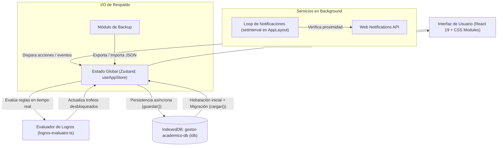

# Gestor Académico Web - Documentación Técnica

Plataforma Web Integral de Gestión Universitaria, Planes de Estudio y Seguimiento Académico

---

## 📝 Descripción General

**Gestor Académico Web** es una aplicación web interactiva (Single Page Application - SPA / Progressive Web App) diseñada para estudiantes universitarios y de educación superior. Su propósito principal es centralizar y optimizar la administración de la trayectoria académica completa: desde la visualización de la malla curricular y correlatividades hasta la gestión diaria de clases, evaluaciones, hábitos de estudio y proyecciones de graduación.

La aplicación opera directamente en el navegador del usuario utilizando tecnologías web modernas. Ofrece una experiencia fluida, reactiva y personalizada mediante interfaces visuales avanzadas (árboles de materias basados en grafos con nodos interactivos, calendario dinámico, grilla semanal de horarios y temporizador Pomodoro integrado), gestionando el estado en memoria de forma reactiva y persistiendo los datos de manera estructurada en el almacenamiento local del cliente (IndexedDB).

---

## 🛠️ Stack Tecnológico

* **Entorno y Herramientas de Construcción:** Node.js, Vite 8 (Bundler ultrarrápido con Hot Module Replacement), TypeScript 6 (Tipado estricto en todo el codebase).
* **Biblioteca Principal y Enrutamiento:** React 19 (Arquitectura basada en componentes funcionales y hooks modernos), React Router DOM 7 (Enrutamiento declarativo para SPAs).
* **Gestión de Estado:** Zustand 5 (Gestión de estado global reactiva, centralizada y predecible).
* **Persistencia en el Cliente:** IndexedDB gestionado a través de la biblioteca `idb` (almacén estructurado asíncrono en la base de datos `gestor-academico-db`).
* **Visualización de Grafos y Diagramas:** `@xyflow/react` (React Flow 12) para el canvas interactivo con nodos personalizables, arrastre fluido y aristas dirigidas de correlatividades.
* **Componentes de UI y Visualización de Datos:**
  * Recharts (Renderizado de gráficos estadísticos y distribución de notas).
  * React Big Calendar & date-fns (Planificador visual de eventos y exámenes).
  * Radix UI (`@radix-ui/react-dialog`) para accesibilidad y modales desacoplados.
  * Lucide React (Sistema de iconografía vectorial unificado).
  * Driver.js (Sistema de tutorial guiado e inducción interactiva).
* **Internacionalización y Notificaciones:** `i18next` y `react-i18next` (Soporte multilenguaje español/inglés), Web Notifications API del navegador.
* **Pruebas y Calidad de Código:** Vitest, Testing Library (`@testing-library/react`), jsdom, Oxlint.

---

## 🔄 Flujo de Datos y Arquitectura

### Ciclo de Vida y Pipeline de Datos:
1. **Inicialización e Hidratación:**
   Al montar la aplicación en `App.tsx`, se ejecuta la acción `cargar()` del store de Zustand. La aplicación muestra un `SplashScreen` mientras lee los registros de `gestor-academico-db` en IndexedDB. Se realiza una mezcla profunda (*deep merge*) entre la configuración por defecto y los datos recuperados para asegurar retrocompatibilidad con esquemas antiguos.
2. **Ciclo Reactivo de UI:**
   Los componentes de cada vista (Dashboard, Grafo, Calendario, Pomodoro, Metas, etc.) se suscriben a segmentos específicos de `useAppStore`. Cualquier interacción (crear materia, registrar nota, iniciar sesión pomodoro) despacha métodos que actualizan el estado in-memory.
3. **Persistencia Automatizada:**
   Cada mutación del store invoca internamente la rutina asíncrona de guardado en IndexedDB, garantizando que el usuario mantenga su progreso sin necesidad de botones de guardado manual, salvo en interacciones continuas de alta frecuencia (como el arrastre de nodos en el grafo, donde la persistencia se pospone al evento final `onNodeDragStop`).
4. **Motor de Gamificación Silencioso:**
   Tras eventos clave en el dominio académico (aprobar materias, alcanzar rachas de estudio o cumplir metas), el módulo `logros-evaluator.ts` inspecciona los criterios y desbloquea medallas automáticamente notificando al usuario.
5. **Monitoreo de Notificaciones:**
   Un temporizador periódico en `AppLayout` monitorea las clases y eventos registrados, emitiendo recordatorios del navegador antes de las fechas límite y horarios programados.

---

## 📦 Módulos y Funcionalidades de la Aplicación

### 1. Panel de Control (Dashboard)
* Vista consolidada con saludo personalizado, fecha actual y métricas clave (porcentaje general de aprobación, materias pendientes y metas alcanzadas).
* Listado cronológico de las clases del día según el semestre activo y próximos compromisos académicos (exámenes, entregas).
* Atajos rápidos a módulos de estudio y registro de actividad.

### 2. Gestión de Carreras y Grafo Curricular Interactivo
* Administración de múltiples carreras simultáneas (nombre, facultad/universidad, año de inicio y código de color representativo).
* Visualización interactiva del plan de estudios con `@xyflow/react`. Representación de materias como nodos con estados diferenciados: *Aprobada*, *Regularizada*, *Cursando*, *Pendiente* y *Bloqueada* (calculado automáticamente según prerrequisitos/correlatividades).
* Modal de edición integral por materia: carga de calificaciones parciales y finales, cálculo de nota definitiva, notas rápidas categorizadas (prioridades ALTA/MEDIA/BAJA) y asignación de horarios/aulas.

### 3. Planificador Semanal y Grilla de Horarios
* Matriz visual semanal de cursada con bloques horarios automáticos por día, aula y docente.
* Filtro configurable por *Semestre Activo* para evitar saturación de pantalla con materias de períodos pasados o futuros.

### 4. Calendario Académico
* Calendario interactivo (`react-big-calendar`) para visualizar fechas críticas clasificadas por tipo: Exámenes, Entregas, Clases, Reuniones y Otros.
* Gestión completa de eventos con código cromático asociado a la materia o carrera.

### 5. Técnica Pomodoro & Hábitos de Estudio
* Temporizador configurable de trabajo concentrado, descansos cortos y descansos largos.
* Vinculación de sesiones a materias y carreras específicas.
* Historial de concentración, métricas de minutos estudiados y contador de rachas diarias con alertas sonoras.

### 6. Sistema de Metas Académicas
* Definición de metas cuantitativas orientadas a objetivos: aprobación de cantidad de materias, mantenimiento de promedio mínimo, cumplimiento de horas de estudio o fechas límite.
* Seguimiento visual de porcentaje completado y marcado automático al alcanzar el umbral.

### 7. Sistema de Logros (Gamificación)
* Catálogo de 24 trofeos con diferentes niveles de rareza basados en hitos reales (aprobar la primera materia, obtener promedios destacados, completar semestres, mantener constancia en Pomodoro, personalizar la aplicación, etc.).

### 8. Inteligencia Académica (Simulador y Estimaciones Matemáticas)
* **Simulador de Promedio:** Herramienta analítica que permite ingresar calificaciones hipotéticas para simular y predecir su impacto directo sobre el promedio general acumulado.
* **Estimador de Graduación:** Algoritmo de proyección estadística que evalúa el ritmo histórico de materias aprobadas por año transcurrido, proyectando de forma determinista el año estimado de finalización de la carrera.
> *Nota Técnica: Este módulo funciona mediante algoritmos y modelos matemáticos deterministas ejecutados en el cliente; no requiere servidores externos ni modelos de lenguaje generativos.*

### 9. Estadísticas y Métricas Gráficas
* Dashboard analítico con gráficos interactivos (`recharts`): distribución de notas, avance porcentual por ciclo y comparativas de rendimiento.

### 10. Respaldo y Portabilidad de Datos (Backup)
* Exportación completa del estado de la aplicación en formato estructurado JSON.
* Restauración de copias de seguridad con validación previa de integridad de datos e hidratación reactiva inmediata.

### 11. Personalización Visual y Accesibilidad
* Soporte para temas Claro, Oscuro y Sincronización con el Sistema Operativo.
* Paletas de colores de acento configurables, fuentes personalizadas y fondos visuales (sólido, gradiente o imagen).
* Estilos personalizables para nodos del grafo (cuadrado, redondeado, pastilla, burbuja, minimalista).
* Modo Zen para estudio libre de distracciones y paleta de comandos rápida (`Ctrl + K`).

---

## 🛡️ Consideraciones Técnicas, Resiliencia y Buenas Prácticas

* **Seguridad y Privacidad por Diseño (Client-Side Privacy):**
  La totalidad de la información académica del usuario reside en el almacenamiento de su propio navegador web (IndexedDB). No se envían datos personales, calificaciones ni calendarios a servidores remotos no autorizados.
* **Aislamiento de Fallos con Error Boundaries:**
  Las vistas secundarias y componentes del árbol de rutas están encapsulados dentro de un `ErrorBoundary` (`src/components/common/ErrorBoundary.tsx`). Si ocurre un fallo inesperado en el renderizado de una pantalla, la aplicación evita la pantalla en blanco general, permitiendo al usuario navegar a otra sección o recargar el estado.
* **Hidratación y Migración Segura de Esquemas:**
  El método de carga implementa un mapeo con valores por defecto que previene excepciones por propiedades indefinidas en versiones anteriores del esquema persistido.
* **Desacoplamiento de Persistencia de Alta Frecuencia:**
  Para optimizar el rendimiento gráfico del canvas en el grafo de materias (60 fps en arrastre de nodos), los cambios continuos de coordenadas se mantienen en memoria volátil y solo se persisten en base de datos al finalizar el evento de arrastre (`onNodeDragStop`).

---

## 🚀 Desafíos Técnicos y Resoluciones

* **Desafío 1: Coordinación de rendimiento en el canvas de grafos interactivos.**
  * *Síntoma:* El guardado constante en IndexedDB durante el arrastre de nodos generaba bloqueos de renderizado y pérdida de fluidez visual.
  * *Resolución:* Separación estricta entre el renderizado de posición reactivo en React Flow y la serialización en base de datos, delegando la persistencia únicamente al evento `onNodeDragStop`.

* **Desafío 2: Retrocompatibilidad en el almacenamiento IndexedDB ante nuevas funcionalidades.**
  * *Síntoma:* Al agregar nuevas propiedades al modelo de datos (nuevos campos en configuración o logros), usuarios con versiones almacenadas previamente experimentaban inconsistencias al leer campos no inicializados.
  * *Resolución:* Implementación de un patrón de hidratación con *deep merge* dentro de `useAppStore.ts` (`datosMigrados`), combinando las estructuras por defecto del sistema con los registros recuperados de `idb`.

* **Desafío 3: Disparo confiable de notificaciones sin saturar al sistema operativo.**
  * *Síntoma:* Las verificaciones periódicas de eventos y horarios podían emitir alertas duplicadas en ventanas de tiempo consecutivas.
  * *Resolución:* Inclusión de marcas de estado booleanas en los eventos (`notificadoDiaAnterior`, `notificadoMismoDia`) y filtros basados en intervalos temporales específicos que evitan la emisión redundante de avisos en el navegador.
